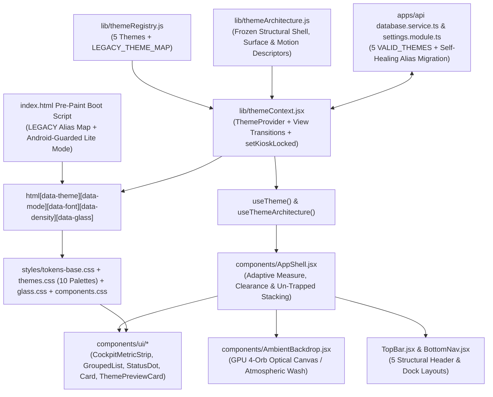

# ZayedMart V2 — Architectural Theme Engine & Design System (`THEMES_DESIGN_SYSTEM.md`)

> **Platform:** ZayedMart Retail Operations Web App + PWA + Capacitor Android APK (`apps/web`, `apps/api`)  
> **Direction:** Arabic RTL-First (`dir="rtl"`, `lang="ar"`) Operational UI — *Anti-AI Detox & Pure Operational Cockpit*  
> **Engine:** **5 Mastercrafted Architectural Themes × Light & Dark (`10` Palettes, `1,094/1,094` WCAG 2.2 AA+/AAA Verified Assertions, `0` Failures)**  
> **Stack:** Core JS Architectural Descriptors (`themeArchitecture.js`) + CSS Custom Properties (`[data-theme][data-mode]`) + Tailwind CSS v4 `@theme inline` + View Transitions API + Chrome 64+ / Budget Android WebView Fallbacks

---

## 1. System Overview & V2 Architectural Paradigm

ZayedMart V2 is a **structural shell-switching UI engine**, not a color swapper. Switching themes transforms page chrome geometry (`TopBar`, `BottomNav`, `AppShell`), ambient optical backdrops (`AmbientBackdrop`), card/list container physics (`CockpitMetricStrip`, `GroupedList`, `.g-card`), typography weight, and motion signature across real supermarket conditions (bright-daylight wall kiosks, one-handed smartphones, CCTV monitoring desks, and budget 1GB–2GB Android Go handsets).

### Core Engineering Invariants
1. **5 Mastercrafted Architectural Themes × 100% Light & Dark Parity (10 Palettes):** Every palette is composed individually (never mechanically inverted) and verified across **1,094 deterministic WCAG 2.2 AA+/AAA contrast assertions** (`text ≥ 9.38:1`, `muted ≥ 6.30:1`, `primary ≥ 5.55:1`, `solid CTAs ≥ 4.77:1`, `border-strong ≥ 3.91:1`, including worst-case `liquid-glass` `saturate(210%)` + 2-orb overlap compositing).
2. **Zero-FOUC Cold Boot & Fixed Android Lite Guard (`apps/web/index.html`):** A synchronous pre-paint boot script resolves `data-theme` (including `LEGACY` alias migration), `data-mode`, `data-font`, `data-density`, `data-glass`, `scale-*`, `lite-mode`, `<meta name="theme-color">`, and `ZayedAndroidBridge.setSystemBars` **before first paint**. The `hardwareConcurrency <= 4` auto-lite heuristic is strictly gated behind `/Android/i` so 4-core desktops/tablets never boot into `lite-mode` accidentally.
3. **Seamless Architectural Crossfade (`lib/themeContext.jsx` & `styles/tokens-base.css`):** Explicit user switches trigger the **View Transitions API** (`220ms cubic-bezier(0.23, 1, 0.32, 1)` with a subtle `2px` optical blur bridge via `gThemeFadeOut` / `gThemeFadeIn`), falling back on Chrome 64–110 / Lite Mode / Reduced Motion to an **atomic 1-frame `html.theme-switching` hard style reset** (`transition: none !important`) without reloading the app or interrupting Walkie-Talkie / offline sync streams.
4. **Chrome 64+ & Capacitor WebView Safety:** `vite.config.js` targets `cssTarget: 'chrome64'`. All dynamic tokens use standard sRGB `#RRGGBB` and explicit `rgba(...)` values — zero `oklch()`, zero `color-mix()`, zero `bg-[var(--g-*)]/opacity`.
5. **Kiosk Mode Daylight Invariant:** Calling `themeCtx.setKioskLocked(role === 'kiosk')` synchronously forces `classic:light` + `data-kiosk="true"`, unmounts `<AmbientBackdrop />`, disables blur, and cleanly restores the user's chosen architectural theme upon exiting Kiosk Mode.
6. **Transparent Legacy Theme Migration (Client + Server):** Users migrating from older preferences (`nordic`, `cyber-ops`, `desert-sand`) are transparently migrated via `LEGACY_THEME_MAP` (`apps/web/src/lib/themeRegistry.js`), `LEGACY` (`apps/web/index.html`), and `LEGACY_THEME_ALIAS_MAP` / `normalizeServerTheme()` (`apps/api/src/database/database.service.ts` + `apps/api/src/settings/settings.module.ts`) on both write (`PUT /api/profile/me/preferences`) and read (`/api/bootstrap`, `/api/profile/me`, `/api/auth/me`):
   - `nordic` → `minimal`
   - `cyber-ops` → `modern`
   - `desert-sand` → `elegant`

---

## 2. The 5 Mastercrafted Architectural Themes (`lib/themeArchitecture.js` & `lib/themeRegistry.js`)

| # | `data-theme` ID | Arabic Name | English Name | Header Architecture (`headerLayout`) | Mobile Dock (`bottomNavLayout`) | Surface & Card Physics (`surfaces.architecture`) | KPI Strip (`kpiLayout`) | Filter Rail (`filterRailStyle`) | Default Font |
|---|---|---|---|---|---|---|---|---|---|
| 1 | `classic` *(default)* | **كلاسيك** | Classic | `classic-clean` (clean ZayedMart header + `2px` blue top hairline) | `classic-m3-pill` (M3 tonal pill indicator) | `m3-elevated` (`1.125rem` card / `0.875rem` btn, soft elevation) | `m3-cards` | `pill` | `Cairo` |
| 2 | `minimal` | **البساطة** | Minimal | `minimal-slim` (**52px** single-row typographic bar, `1px` border-b, 1-word underlined links, 0 pills, 0 brand strip) | `minimal-hairline` (`1px` border-t, monochrome + `4px` ink active dot) | `flat-hairline` (pure `#FFFFFF`/`#0A0A0A` canvas, `6px` cards, **0 shadows**, global `.g-card .g-card` de-boxing) | `hairline-strip` (open `1px` hairline grid on canvas) | `underline` | `IBM Plex Sans Arabic` |
| 3 | `liquid-glass` | **الزجاج السائل** | Liquid Glass | `floating-glass-capsule` (detached frosted capsule with Fresnel `::before` 1px rim & liquid active pill) | `floating-glass-dock` (detached iOS 26 floating dock + glowing liquid bubble indicator) | `optical-glass` (`blur(32/36px) saturate(210%)` + 4 GPU drifting radial orbs + Fresnel rim + press sheen) | `glass-tiles` (4 detached `rounded-[20px]` frosted panes) | `glass` | `Readex Pro` |
| 4 | `elegant` | **الفاخر** | Elegant | `editorial-rule` (warm ivory/obsidian bar + `1px` champagne-gold bottom hairline) | `editorial-hairline` (warm hairline dock + `2px` champagne top indicator) | `editorial-hairline` (`10px` card / `8px` btn, antique emerald + champagne accents, quiet shadows) | `editorial-strip` (bordered hairline strip) | `underline` | `Tajawal` |
| 5 | `modern` | **العصري** | Modern | `studio-segmented` (crisp studio bar with recessed segmented pill track) | `floating-studio-dock` (detached rounded-2xl floating dock + sharp tile indicator) | `tonal-studio` (crisp cobalt `#1D4ED8` / `#60A5FA` + teal `#0F766E` / `#2DD4BF` — zero AI purple) | `studio-bento` | `studio` | `IBM Plex Sans Arabic` |

### Dynamic Per-Theme Chrome Geometry (`styles/themes.css` & `styles/tokens-base.css`)
Every theme sets exact safe-area-aware heights so `SmartFab`, `WalkieFloatingDock`, `ToastHost`, and `<AppShell>` bottom clearance never overlap floating capsules or docks:

| Theme | `--topbar-h` | `--bottom-nav-h` | `<AppShell>` Content Measure |
|---|---|---|---|
| `classic` | `calc(3.75rem + var(--safe-top))` | `calc(4.5rem + var(--safe-bottom))` | `max-w-7xl` |
| `minimal` | `calc(3.25rem + var(--safe-top))` *(52px)* | `calc(3.85rem + var(--safe-bottom))` | `max-w-6xl` |
| `liquid-glass` | `calc(4.65rem + var(--safe-top))` | `calc(5.25rem + var(--safe-bottom))` | `max-w-7xl` |
| `elegant` | `calc(3.65rem + var(--safe-top))` | `calc(4.25rem + var(--safe-bottom))` | `max-w-6xl` |
| `modern` | `calc(3.75rem + var(--safe-top))` | `calc(5.1rem + var(--safe-bottom))` | `max-w-7xl` |

---

## 3. True Minimalism & True Apple iOS 26 / visionOS Optical Liquid Glass

### 3.1 Pure Swiss / Linear Minimalism (`[data-theme='minimal']`)
- Pure high-contrast canvas: `#FFFFFF` (Light) and `#0A0A0A` (Dark), with elevated sheets at `#FFFFFF` / `#121214` so modals stay clearly separated over the scrim.
- Zero drop shadows, sharp `6px` (`0.375rem`) card/button radius, inverted monochrome primary CTAs (`#111111` on `#FFFFFF` in Light; **`#F4F4F5` surface with `#0A0A0A` ink** via `--g-on-primary` in Dark).
- **Global De-Boxing (`styles/components.css`):** Any `.g-card` nested inside another `.g-card` automatically loses its outer box/border/radius and converts into a transparent hairline-divided section (`border-top: 1px solid var(--g-border-subtle)`). `.g-grouped-list` sits flush on canvas (`border-y border-line`, `background: transparent`).
- `<AmbientBackdrop />` returns `null` (**0 DOM nodes, 0 GPU cost**).

### 3.2 Apple iOS 26 / visionOS Optical Liquid Glass (`[data-theme='liquid-glass']`, `styles/glass.css`)
1. **Un-Trapped Living GPU Multi-Orb Backdrop (`AmbientBackdrop.jsx`):** Mounted as a `position: fixed; inset: 0; z-index: 0; contain: strict` sibling inside `<AppShell>` (never wrapping `position: sticky` or `position: fixed` descendants!). Renders 4 spatially separated 5-stop `radial-gradient` orbs (`.g-ambient-orb--1..4`) drifting softly via `translate3d` — zero full-screen `filter: blur()` so mobile Chromium and Safari stay 60fps.
2. **Optical Refractive Panes:** `.g-card`, `.g-glass-pane`, `.g-glass-capsule`, `.g-glass-dock`, `.g-dialog-sheet`, and `.g-glass-pill` apply `backdrop-filter: blur(32px)` / `blur(36px)` + `saturate(210%)` over explicit `rgba(...)` glass tints (`rgba(255,255,255,0.48)` Light / `rgba(14,24,44,0.46)` Dark for panes; `0.62` / `0.60` for floating capsules, docks, and sheets).
3. **Directional 1px Fresnel Specular Edge Rim:** Guarded by `@supports ((mask-composite: exclude) or (-webkit-mask-composite: xor))`, a `::before` pseudo-element paints `--g-glass-rim-gradient` along a crisp 1px directional top-left light catch without altering layout flow. (`position: relative` is applied ONLY to `.g-card`, `.g-glass-pane`, `.g-glass-capsule` — NEVER overriding `sticky` `.g-header` or `fixed` `.g-bottom-nav`.)
4. **Zero Nested GPU Blur Passes:** Nested `.g-card` / `.g-glass-pane` / `.g-search-bar` inside frosted parents reset `backdrop-filter: none`, hide `::before`, and resolve cleanly to `--g-surface-inset`.
5. **3-Tier Optical Degradation Contract:**

| Tier | Trigger Condition | Active Optical Behavior |
|---|---|---|
| **Tier 1 — Full Optical** | Modern GPU + `data-glass="auto"` + `!lite-mode` + `!isKioskLocked` | 4 drifting radial orbs + `blur(32px)`/`blur(36px)` + `saturate(210%)` + Fresnel `::before` 1px rim + specular inner glow + press sheen. |
| **Tier 2 — Reduced** | `html[data-glass="reduced"]` | Orbs freeze static (`animation: none`), blur caps at `10px`/`12px`, saturate `130%`, opacity rises to `0.86`/`0.92` (Light) and `0.88`/`0.94` (Dark). |
| **Tier 3 — Solid Safe** | `html[data-glass="off"]`, `html.lite-mode`, `html[data-kiosk="true"]`, `@media (prefers-reduced-transparency: reduce)`, or `@supports not (backdrop-filter: blur(1px))` | `<AmbientBackdrop />` unmounts/hides, all `backdrop-filter` and `::before` rims disable, surfaces resolve cleanly to solid WCAG-verified `--g-surface` (`#F4F9FF` / `#101B30`). |

---

## 4. Complete 10-Palette Token Reference & WCAG 2.2 AA+/AAA Contrast Matrix

### 4.1 Core Hex & Geometry Matrix (`apps/web/src/styles/themes.css`)
*(Preserves exact `:root.dark-theme:not([data-theme]), [data-theme='classic'][data-mode='dark']` selector specificity so legacy `.dark-theme` never overrides non-classic dark themes.)*

| Theme | Mode | `--g-bg` | `--g-surface` | `--g-surface-2` | `--g-border` / `--g-border-strong` | `--g-text` / `--g-muted` | `--g-primary` | `--g-primary-solid` / `--g-on-primary` | `--g-accent` | Card / Btn Radius |
|---|---|---|---|---|---|---|---|---|---|---|
| `classic` | Light | `#F8FAFD` | `#FFFFFF` | `#EDF2FA` | `#C9D3E0` / `#758294` | `#1A1D21` / `#4E5661` | `#0B57D0` | `#0B57D0` / `#FFFFFF` | `#00639B` | `1.125rem` / `0.875rem` |
| `classic` | Dark | `#131416` | `#1D1F22` | `#272A2E` | `#42464C` / `#7B818A` | `#E8EAED` / `#A8AEB6` | `#9FC5FF` | `#1768D6` / `#FFFFFF` | `#7FCFFF` | `1.125rem` / `0.875rem` |
| `minimal` | Light | `#FFFFFF` | `#FFFFFF` | `#F4F4F5` | `#E4E4E7` / `#71717A` | `#111111` / `#52525B` | `#111111` | `#111111` / `#FFFFFF` | `#1F5C8B` | `0.375rem` / `0.375rem` |
| `minimal` | Dark | `#0A0A0A` | `#0A0A0A` | `#17171A` | `#26262A` / `#71717A` | `#F4F4F5` / `#A1A1AA` | `#F4F4F5` | `#F4F4F5` / **`#0A0A0A`** | `#8BC5F0` | `0.375rem` / `0.375rem` |
| `liquid-glass` | Light | `#DCEEFF` | `#F4F9FF` | `#E6F1FC` | `#B5CCE6` / `#5C7699` | `#091324` / `#21324A` | `#003D99` | `#005CC8` / `#FFFFFF` | `#02516B` | `1.5rem` / `9999px` |
| `liquid-glass` | Dark | `#040B1A` | `#101B30` | `#182742` | `#33486B` / `#6D89B5` | `#F5F9FF` / `#BCD0EB` | `#96D0FF` | `#1565D4` / `#FFFFFF` | `#82F0FC` | `1.5rem` / `9999px` |
| `elegant` | Light | `#FAF7F2` | `#FFFFFF` | `#F2ECE1` | `#DED4C4` / `#847765` | `#1D1915` / `#595147` | `#134E39` | `#134E39` / `#FFFFFF` | `#865D10` | `0.625rem` / `0.5rem` |
| `elegant` | Dark | `#110E0C` | `#1A1613` | `#241F1B` | `#3F372F` / `#827567` | `#F5F0E7` / `#B4A899` | `#E6C06C` | `#196B4C` / `#FFFFFF` | `#E6C06C` | `0.625rem` / `0.5rem` |
| `modern` | Light | `#F6F7FA` | `#FFFFFF` | `#ECEFF5` | `#D5DBE7` / `#727D94` | `#0F172A` / `#475569` | `#1D4ED8` | `#1D4ED8` / `#FFFFFF` | `#0F766E` | `0.75rem` / `0.625rem` |
| `modern` | Dark | `#0B0E14` | `#121722` | `#1A2130` | `#2D374C` / `#6B7B99` | `#F1F5F9` / `#9CA9C0` | `#60A5FA` | `#2563EB` / `#FFFFFF` | `#2DD4BF` | `0.75rem` / `0.625rem` |

### 4.2 Liquid Glass Optical Layer Tokens
| Token | `liquid-glass:light` | `liquid-glass:dark` |
|---|---|---|
| `--g-surface-glass` | `rgba(255, 255, 255, 0.48)` | `rgba(14, 24, 44, 0.46)` |
| `--g-surface-glass-strong` | `rgba(255, 255, 255, 0.62)` | `rgba(12, 20, 38, 0.60)` |
| `--g-surface-glass-press` | `rgba(255, 255, 255, 0.64)` | `rgba(24, 40, 72, 0.58)` |
| `--g-glass-control` | `rgba(255, 255, 255, 0.44)` | `rgba(255, 255, 255, 0.08)` |
| `--g-glass-pill-active` | `rgba(255, 255, 255, 0.78)` | `rgba(148, 210, 255, 0.16)` |
| `--g-surface-inset` | `rgba(255, 255, 255, 0.34)` | `rgba(255, 255, 255, 0.05)` |
| `--g-glass-border` | `rgba(255, 255, 255, 0.58)` | `rgba(186, 230, 253, 0.18)` |
| `--g-blur-md` / `--g-blur-lg` | `32px` / `36px` | `32px` / `36px` |
| `--g-glass-saturate` | `210%` | `210%` |

### 4.3 Verified WCAG 2.2 AA+/AAA Contrast Matrix (`1,094/1,094` Passed — `0` Failures)
Verified directly against live `apps/web/src/styles/themes.css` across `surface`, `bg`, `surface-2`, tonal chips, solid CTA buttons, snackbars (`>= 7.0:1`), interactive `border-strong` (`>= 3.0:1`), plus worst-case `liquid-glass` raw canvas over all 4 orbs, 2-orb quadrant overlap (`35%`), `saturate(210%)` amplification, frosted panes, floating dock, and active liquid pill:

| Theme | Mode | Text (min) | Muted (min) | Primary (min) | Btn CTA | Success (min) | Warning (min) | Danger (min) | Border Strong |
|---|---|---:|---:|---:|---:|---:|---:|---:|---:|
| `classic` | Light | **15.05:1** | 6.61:1 | 5.68:1 | 6.39:1 | 5.24:1 | 5.26:1 | 5.55:1 | 3.91:1 |
| `classic` | Dark | **11.96:1** | 6.45:1 | 8.17:1 | 5.27:1 | 5.43:1 | 5.09:1 | 5.80:1 | 4.21:1 |
| `minimal` | Light | **17.18:1** | 7.03:1 | 17.18:1 | 18.88:1 | 7.38:1 | 5.91:1 | 6.43:1 | 4.83:1 |
| `minimal` | Dark | **16.28:1** | 6.98:1 | 16.28:1 | 18.01:1 | 5.96:1 | 5.10:1 | 6.08:1 | 4.10:1 |
| `liquid-glass` | Light | **10.44:1** | 7.28:1 | 5.55:1 | 6.24:1 | 5.24:1 | 5.20:1 | 4.77:1 | 4.40:1 |
| `liquid-glass` | Dark | **9.38:1** | 6.30:1 | 6.02:1 | 5.46:1 | 5.53:1 | 5.06:1 | 5.12:1 | 4.83:1 |
| `elegant` | Light | **14.86:1** | 6.63:1 | 8.21:1 | 9.65:1 | 6.68:1 | 5.29:1 | 6.46:1 | 4.37:1 |
| `elegant` | Dark | **14.38:1** | 7.00:1 | 9.42:1 | 6.46:1 | 5.83:1 | 4.89:1 | 6.22:1 | 4.01:1 |
| `modern` | Light | **15.50:1** | 6.58:1 | 5.82:1 | 6.70:1 | 4.91:1 | 5.32:1 | 5.24:1 | 4.14:1 |
| `modern` | Dark | **14.70:1** | 6.79:1 | 6.33:1 | 5.17:1 | 5.78:1 | 5.09:1 | 6.29:1 | 4.20:1 |

---

## 5. Arabic Typography, Vector Icons & Scale System (`styles/fonts.css`, `components/ui/Icon.jsx`)

1. **4 Curated Arabic UI Families + Always-Offline Local Fallback (`Tajawal`):**
   - `--font-cairo`: `'Cairo', 'Tajawal', 'Readex Pro', system-ui, sans-serif` (default for `classic`)
   - `--font-ibm`: `'IBM Plex Sans Arabic', 'Tajawal', 'Cairo', system-ui, sans-serif` (default for `minimal`, `modern`)
   - `--font-tajawal`: `'Tajawal', 'Cairo', 'IBM Plex Sans Arabic', system-ui, sans-serif` (default for `elegant`; bundled locally under `/public/Tajawal/*.ttf`)
   - `--font-readex`: `'Readex Pro', 'Tajawal', 'Cairo', system-ui, sans-serif` (default for `liquid-glass`)
2. **Bundled Human-Crafted Vector Icons (`@phosphor-icons/react` via `components/ui/Icon.jsx`):**
   - Zero Material Symbols font ligatures (`.ms-icon`) and zero external icon CDN requests — every UI glyph is tree-shaken directly into the Vite bundle for instant offline/WebView rendering.
   - `<Icon />` resolves semantic weights (`regular`, `fill`, `duotone`, `bold`) and auto-mirrors directional glyphs (`logout`, `send`) in RTL.
   - Radio hardware dock (`--g-radio-*`) uses restrained pro-hardware slate surfaces (`#111317`/`#1A1E26`) paired with emerald (`#10B981`/`#34D399`) and rose (`#F43F5E`) signal accents.
3. **Tabular LTR Numerals (`.num-ltr`):** `font-variant-numeric: tabular-nums; direction: ltr; unicode-bidi: isolate;` without overriding `display` so flex/grid containers stay intact.
4. **Root Font Scaling & OLED Dark Compensation:** `scale-normal` (`16px`), `scale-large` (`17.5px`), `scale-xlarge` (`19px`); `[data-mode="dark"]` applies `-webkit-font-smoothing: antialiased` and `line-height: 1.6`.

---

## 6. Component Authoring Guardrails

| Rule | DO | DON'T |
|---|---|---|
| **Primary CTAs** | `<Button variant="primary">` or `bg-primary-solid text-on-primary` | `bg-[var(--g-primary)] text-white` (breaks `minimal:dark` `#F4F4F5` button!) |
| **Surfaces & Lists** | `<GroupedList>`, `<CockpitMetricStrip>`, `<Card>`, `bg-surface`, `bg-canvas` | Nested boxes-inside-boxes, `bg-white` (except QR `` quiet zone), raw `#hex` |
| **Translucent Glass** | `.g-glass-pane`, `.g-glass-capsule`, `.g-glass-dock`, `var(--g-surface-glass)` | `oklch()`, `color-mix()`, `bg-[var(--g-*)]/opacity` |
| **Icons** | `<Icon name="..." />` (`@phosphor-icons/react`) | `.ms-icon` font spans or external Google Material Symbols `<link>` |
| **Motion** | Explicit property transitions (`transition-[transform,background-color,color]`) + `@media (hover: hover) and (pointer: fine)` | `transition-all`, sticky hover lifts on touch devices |
| **Stacking Safety** | Mount `<AmbientBackdrop />` as a sibling in `<AppShell>`, keep `<main>` untrapped (`z-index: auto`), portal modals to `document.body` (`data-modal-open="true"`) | Place `z-index`/`backdrop-filter`/`transform` on any ancestor of `BottomNav`, `BottomSheet`, `SmartFab`, or `WalkieFloatingDock` |
| **Status Signals** | `<StatusDot tone="..." label="..." />` (max 1 signal per row) | 3–6 stacked `<Badge>` pills, Unicode emojis, or decorative `✓` suffixes |
