# ZayedMart V2 — Operational Cockpit & Anti-AI Detox UI/UX Architecture (`UI_UX_ARCHITECTURE.md`)

> **Platform:** ZayedMart Supermarket Operations Web App + PWA + Capacitor Android (`apps/web`)  
> **Direction:** Arabic RTL-First (`dir="rtl"`, `lang="ar"`, Radix `<DirectionProvider dir="rtl">`), Touch-First (`≥ 44×44px` targets), Offline-First  
> **Design Mandate:** *Radical Anti-AI Detox + Shadcn New York (`minimal` Default) / Apple / Linear Operational Cockpit + Adaptive Chrome Across 5 Mastercrafted Themes* (`minimal`, `classic`, `liquid-glass`, `elegant`, `modern`)

---

## 1. The 10 Iron Laws of ZayedMart V2 (Anti-AI Detox Constitution)

Every screen and shared primitive in `apps/web/src/` follows ten strict design laws that eliminate AI-generated dashboard bloat while preserving **100% of operational features, RBAC gates, offline sync, and Arabic RTL ergonomics**:

1. **Zero Unrequested Prose:** No marketing taglines, explanatory subtitles under headings, helper paragraphs under toggles, or `"how-to-use"` copy. Labels are 1–3 plain Arabic words.
2. **Zero "Everything Is Fine" Filler Boxes:** `DashboardAttentionPanel` returns `null` when 0 alerts exist (no green `"مستقر 100%"` banner); `ScheduleView` hides its Swap Inbox when 0 swaps exist; empty department/handover cards hide completely; initial empty setup uses a single quiet 1-line inline link (`أضف أول موظف +`).
3. **Zero Icon-in-Colored-Square Templates:** No decorative `w-10 h-10` / `w-11 h-11` colored icon squares stamped beside headers, stat cards, toggles, feed rows, or modal titles. Use bare `18px` icons sparingly or an `8px` semantic `<StatusDot />`.
4. **Zero Boxes-Inside-Boxes:** Max 1 surface level per section. Hairline-divided rows (`<GroupedList>` + `divide-y`) replace nested bordered cards and mini stat sub-boxes.
5. **Max 1 Status Signal Per Row:** One `<StatusDot />` (or 1 primary status tag) per row; secondary metadata renders inline as quiet middot-separated muted text (`كاشير · 08:00–20:00 · #101`).
6. **Zero Emojis & Decorative Checkmarks:** Zero Unicode emojis (`[\u{1F300}-\u{1FAFF}\u{2600}-\u{27BF}]`) and zero decorative `✓` suffixes anywhere in `apps/web/src/components/`.
7. **Zero English Parentheticals & Tech Jargon:** Plain Arabic labels only (`الدور`, `اسم المستخدم`, `الشفافية`, `الأداء الخفيف`, `اللاسلكي`); keep only universal operational tokens (`QR`, `DVR`, `Excel`, `Word`, `JSON`, `APK`, `CH-01`, `PIN`).
8. **Zero Duplicate Chrome & Double Alerts:** `SmartAlertsAndHandoverBar` suppresses alert banners on `dashboard` and `settings` (`showBanners={activeTab !== 'dashboard' && activeTab !== 'settings'}`) while still mounting `HandoverModal`; `SettingsView` has zero duplicate top hero card; `AdminDashboard` removes the duplicate `system` tab and routes legacy `system`/`sync` links directly to `SettingsView` (`section='system'`).
9. **Adaptive Structural Chrome per Theme:** `AppShell`, `TopBar`, `BottomNav`, and `components/ui/*` consume `useThemeArchitecture()` so `minimal`, `liquid-glass`, `elegant`, `modern`, and `classic` genuinely change chrome layout, surface physics, and density.
10. **Zero Operational Feature Loss:** 100% of RBAC permissions, CCTV verification, QR print/scan, WhatsApp/Excel/Word export, handover, swap approvals, offline outbox replay, Walkie-Talkie PTT, and `>= 44px` touch targets remain intact.

---

## 2. Adaptive Shell (`AppShell.jsx`), Safe-Area Geometry & Z-Index Ladder

`<AppShell />` (`apps/web/src/components/AppShell.jsx`) wraps the authenticated workspace (inside `<DirectionProvider dir="rtl">` in `main.jsx`, while `<AmbientBackdrop />` also renders behind `<AuthLoginScreen />`). Mounting `<AmbientBackdrop />` as an un-trapped `position: fixed; z-index: 0` sibling ensures `position: sticky` headers/sidebars and `position: fixed` docks/sheets never get trapped inside a `backdrop-filter` or `transform` containing block.

When `arch.shell.sidebarLayout === 'shadcn-collapsible-rail'` (`minimal` default theme), `<AppShell>` mounts `<ShadcnSidebar />` on the logical start side beside the `flex-1 min-w-0` content column on `md+` screens while keeping mobile (`< md`) chrome and the other 4 themes' `<AppShell>` DOM completely unchanged.

### 2.1 Responsive Breakpoints
| Tier | Viewport Range | Structural Adaptation |
|---|---|---|
| **Base (`xs`)** | `320px – 639px` | Single-column flow, 5-slot adaptive `BottomNav` + "المزيد" Sheet, snap-scroll `WeekDayStrip`, 2/3-column mobile `CockpitMetricStrip`, swipe-down mobile `BottomSheet` drawers, theme-adaptive `CH-01` pill (`WalkieFloatingDock`), scroll-aware `SmartFab` (`scrollY > 220`), consolidated mobile Action Sheets (`ScheduleView`, `ShortagesView`), `<GroupedList>` mobile cards (`AttendanceView`, `AdminReportsPanel`), and vertical `44×44px` touch steppers. |
| **`sm`** | `640px – 767px` | 7-column `WeekDayStrip` (`sm:grid-cols-7`), centered modal dialogs (`max-w-lg`), `fullWidthOnMobile` segmented controls dock inline cleanly. |
| **`md`** | `768px – 1023px` | `BottomNav` hides (`md:hidden`); `minimal` activates collapsible RTL `ShadcnSidebar` (`w-64` / `w-16`, `Ctrl/Cmd+B`, `zayed_shadcn_sidebar_collapsed_v1`) + `h-14` breadcrumb `TopBar` while other themes use their single-row desktop `TopBar`; desktop Shadcn `<Table>` views (`ScheduleView`, `AttendanceView` in `minimal`, `AdminReportsPanel`) activate; `ToastHost` moves to bottom-center. |
| **`lg` / `xl`** | `1024px+` | 4-column `CockpitMetricStrip` (`lg:grid-cols-4`), sidebar nav in `SettingsView` (`lg:`), content measure adapts per theme (`max-w-6xl` in `elegant`, `max-w-7xl` in `minimal`/`liquid-glass`/`modern`/`classic`). |

### 2.2 Unified Z-Index Ladder, Document-Body Portals & Non-Collision Chrome

```mermaid
flowchart TD
  subgraph Z90["z-[90] — Portaled Top Toast Notifications"]
    Toast["ToastHost (document.body Portal — Mobile: below TopBar | Desktop: bottom-6)"]
  end
  subgraph Z75["z-[75] — Portaled Media Lightbox"]
    Lightbox["Proof Image Lightbox (document.body Portal)"]
  end
  subgraph Z70["z-[70] — Portaled Radix Dropdowns"]
    Dropdown["DropdownMenuContent (User switcher, theme picker)"]
  end
  subgraph Z62["z-[62+] — Portaled Radix Modal Sheets & Tactical Consoles"]
    Sheet["BottomSheet (Dialog) / ConfirmSheet (AlertDialog) / QrQuickModal / WalkieTalkieConsole (pushModalLayer + data-modal-open=true)"]
  end
  subgraph Z45["z-45 — Incoming Emergency Radio Dispatch"]
    RadioAlert["Walkie Incoming Dispatch Banner (Top-Anchored)"]
  end
  subgraph Z40["z-40 — Dual Thumb-Zone Docks (.g-floating-chrome, hidden when data-modal-open=true)"]
    FAB["SmartFab (Physical Right: right-3 sm:right-6, scroll-aware on mobile)"]
    WalkieDock["WalkieFloatingDock (Physical Left: left-3 sm:left-6, h-11 CH-01 capsule)"]
  end
  subgraph Z35["z-35 / z-30 — Adaptive Navigation Chrome"]
    Sidebar["ShadcnSidebar (minimal desktop sticky collapsible RTL rail, z-30)"]
    TopBar["TopBar (5 headerLayout modes, sticky top-0 z-30)"]
    BottomNav["BottomNav (5 bottomNavLayout modes, fixed bottom-0 z-35)"]
  end
  subgraph Z0["z-0 — Un-Trapped Living Optical Sibling"]
    Backdrop["AmbientBackdrop (position: fixed, inset: 0, contain: strict)"]
  end
```

- **Zero Modal Overlap Guarantee:** `<main>` stays stack-untrapped (no `z-[1]`), every modal layer (`BottomSheet`, `ConfirmSheet`, `WalkieTalkieConsole`, Lightbox, `ToastHost`) portals directly to `document.body` via `pushModalLayer()` / `popModalLayer()`, and `html[data-modal-open="true"] .g-floating-chrome` automatically fades and disables `WalkieFloatingDock` + `SmartFab` while any overlay is active.
- **Dynamic Chrome Tokens (`styles/themes.css`):** `--topbar-h` (`3.5rem` in `minimal` up to `4.65rem` in `liquid-glass` + `--safe-top`) and `--bottom-nav-h` (`3.85rem` in `minimal` up to `5.25rem` in `liquid-glass` + `--safe-bottom`) automatically keep `SmartFab`, `WalkieFloatingDock`, `ToastHost`, and `<AppShell>` bottom padding collision-free across all 5 architectures.
- **Android Hardware Back Stack (`App.jsx`):** Resolves in LIFO order: Lightbox → Walkie Console → QR Modal → Handover Modal → Person Log Modal → Kiosk guard → return to `getPreferredAllowedTab(role, permissions)` → double-press within `2,200ms` exits cleanly.

---

## 3. Arabic RTL Layout & Touch Target Standards

1. **Logical CSS Properties Everywhere:** `ms-*`/`me-*`, `ps-*`/`pe-*`, `start-*`/`end-*`, `text-start`/`text-end`, `border-s`/`border-e`.
2. **Physical Exceptions (Strictly Scoped):**
   - `SmartFab` (`right-3 sm:right-6`) vs `WalkieFloatingDock` (`left-3 sm:left-6`) thumb-zone pinning.
   - Password reveal eye button (`left-1.5` with `pl-12 pr-3.5`) on `dir="ltr"` credential fields so icons never collide with LTR input text or RTL placeholders.
   - `.num-ltr` (`direction: ltr; unicode-bidi: isolate; font-variant-numeric: tabular-nums;`) wrapping numeric tokens individually.
3. **Touch & Input Ergonomics:** Every interactive control enforces `≥ 44×44px` on mobile (`min-h-[44px]`, `w-11 h-11`) and `16px` (`1rem`) minimum input font size on `< 640px` to prevent iOS/Android focus zoom.

---

## 4. Navigation & Adaptive Chrome (`lib/navigation.js`, `ShadcnSidebar.jsx`, `TopBar.jsx`, `BottomNav.jsx`)

`apps/web/src/lib/navigation.js` defines 1-word Arabic navigation labels (`الرئيسية`, `الحضور`, `النواقص`, `الإجازات`, `العربيات`, `الملاحظات`, `التيم`, `الإعدادات`), RBAC capability flags, and preferred landing tabs.

- **`ShadcnSidebar.jsx` (`minimal` Default Desktop Rail — `sidebarLayout: 'shadcn-collapsible-rail'`):**
  - Sticky desktop (`hidden md:flex`) collapsible RTL rail (`w-64` expanded / `w-16` collapsed, persisted in `zayed_shadcn_sidebar_collapsed_v1` with `Ctrl/Cmd+B` shortcut).
  - Contains Brand Header (`<BrandLogo />`, `storeName`, `branchName`), **العمليات** (RBAC-filtered tabs via `buildNavTabs`), **أدوات سريعة** (`QR / كود`, `تسليم الوردية`, `اللاسلكي`, `وضع الكشك`, `الإعدادات`), and a Footer User `DropdownMenu` (Settings, QR Card, Light/Dark toggle, 5-Theme Switcher, Logout).
- **`TopBar.jsx` (5 Structural `headerLayout` Branches):**
  - `shadcn-sidebar-header` (`minimal` default): `56px` (`h-14`) header with desktop sidebar toggle (`<Icon name="sidebar" />`), vertical `<Separator />`, Arabic breadcrumb (`storeName` / active tab), quiet sync dot, date switcher, and Light/Dark toggle; compact mobile header with Account BottomSheet.
  - `floating-glass-capsule`: Detached frosted capsule (`blur(36px) saturate(210%)` + Fresnel `::before` rim + translucent liquid pill active tab).
  - `editorial-rule`: Warm editorial bar with `1px` champagne-gold bottom rule and refined text links.
  - `studio-segmented`: Studio bar with a recessed `bg-surface-2` segmented nav track.
  - `classic-clean`: Clean single-row ZayedMart header with a `2px` blue top hairline.
  - Detox cuts: removed ticking-seconds `LiveClock`, removed duplicate user name under store title, replaced verbose sync prose with an `8px` status dot, and streamlined the Quick Account Sheet (5-theme switcher + `نهاري`/`ليلي` toggle + `الإعدادات` + `خروج`).
- **`BottomNav.jsx` (5 Structural `bottomNavLayout` Branches):**
  - Renders max 4 primary tabs + 1 **"المزيد"** sheet, switching cleanly between `shadcn-dock` (`minimal` default, rounded `bg-surface-2` Zinc active pill), `floating-glass-dock` (detached iOS 26 dock + glowing liquid bubble), `editorial-hairline` (2px champagne top line), `floating-studio-dock` (detached studio dock + sharp tile), and `classic-m3-pill` (M3 tonal pill).

---

## 5. Shared UI Primitives Catalog (`apps/web/src/components/ui/`)

All shared primitives exported from `apps/web/src/components/ui/index.js` combine **Radix UI** accessibility, `class-variance-authority` (`cva`), and `cn()` (`clsx` + `tailwind-merge` in `apps/web/src/lib/utils.js`) with **zero raw hex colors**, **zero colored icon-in-square headers**, and automatic adaptation via `useThemeArchitecture()`:

| Primitive | File | Role & Adaptive Behavior |
|---|---|---|
| **`Table`**, **`TableHeader`**, **`TableBody`**, **`TableRow`**, **`TableHead`**, **`TableCell`** | `Table.jsx` | Responsive Shadcn New York data table primitives (`rounded-[var(--g-radius-card)] border border-line bg-surface shadow-[var(--g-shadow-sm)]`, `.num-ltr`-friendly cells) powering desktop (`hidden md:block`) operational grids while keeping `< md` mobile cards intact. |
| **`Separator`** & **`DropdownMenu*`** | `Separator.jsx`, `DropdownMenu.jsx` | Backed by `@radix-ui/react-separator` and `@radix-ui/react-dropdown-menu` (`z-[70]`, `.g-radix-popover` animations, `40px` min item height, submenus & destructive actions). |
| **`CockpitMetricStrip`** *(alias `MetricStrip`)* | `CockpitMetricStrip.jsx` | Adaptive 2/3/4-cell operational metric strip (3 elements per cell: label + optional `8px` dot, big `.num-ltr` value, 1 real secondary datum). Renders Dashboard-01 `shadcn-cards` in `minimal`, bordered strip in `elegant`, detached frosted `g-glass-pane` tiles in `liquid-glass`, and crisp tiles in `modern`/`classic`. |
| **`GroupedList` & `GroupedRow`** | `GroupedList.jsx` | Apple iOS / Linear hairline-divided list container eliminating boxes-inside-boxes. Bordered Zinc list in `minimal`, frosted `g-glass-pane` in `liquid-glass`, crisp surface in `elegant`/`modern`/`classic`. |
| **`StatusDot`** | `StatusDot.jsx` | Quiet `8px` semantic status dot (`neutral \| primary \| success \| warning \| danger \| purple`) + optional 1–2 word label and `pulse` indicator (replaces loud pill stacks). |
| **`SectionHeader`** | `SectionHeader.jsx` | Zero colored icon square; crisp heading (`arch.surfaces.headingWeight`), subtle `.num-ltr` inline count, optional factual datum, end-aligned actions, hairline bottom rule in `minimal`/`elegant`. |
| **`ThemePreviewCard`** | `ThemePreviewCard.jsx` | Scoped `
` **pure geometric architectural wireframe** thumbnail + 1–2 word Arabic theme name (`minimal` shows collapsible RTL rail + Zinc cards + bottom dock + `"افتراضي"` badge when `isDefault`). |
| **`FilterChipRail`** | `FilterChipRail.jsx` | Defaults to text-only (`showIcons = false`); inline muted tabular counts (no pills-inside-pills). Auto-switches between `shadcn-tabs` (`minimal`), `underline` (`elegant`), `glass` (`liquid-glass`), `studio` (`modern`), and `pill` (`classic`). |
| **`ToggleSwitch`** & **`SegmentedControl`** | `ToggleSwitch.jsx`, `SegmentedControl.jsx` | Backed by `@radix-ui/react-switch` (RTL thumb translation, `>= 48px` row target) and `@radix-ui/react-tabs` (RTL arrow navigation, elevated `minimal` active tab). |
| **`EmptyState`** | `EmptyState.jsx` | Transparent directly on canvas (no outer `<Card>` box or giant icon square), supports `compact` 1-line inline mode. |
| **`BottomSheet`** | `BottomSheet.jsx` | Backed by `@radix-ui/react-dialog` portaled to `document.body` (`zIndex = 62+`, `data-modal-open="true"`, `.g-radix-overlay`/`.g-radix-dialog`), keyboard-safe sticky header/footer, `44×44px` close trigger, ref-counted scroll lock, and **touch swipe-down-to-dismiss mobile drawer gesture** (`< 640px`, dismiss on `dragY >= 96` or velocity `> 0.45 px/ms` without blocking inner `.g-dialog-body` scrolling). |
| **`ConfirmSheet`** | `ConfirmSheet.jsx` | Backed by `@radix-ui/react-alert-dialog` synced with `pushModalLayer()` / `popModalLayer()`, blocking dismissal while `loading` and replacing all native `window.confirm()`. |
| **`Icon`**, **`Button`**, **`Badge`**, **`Card`**, **`StatCard`**, **`SearchFilterBar`**, **`SmartFab`**, **`RoleAvatar`** (`Avatar`), **`ToastHost`**, **`BrandLogo`**, **`WeekDayStrip`**, **`SkeletonKpiStrip` / `SkeletonList`** | `components/ui/*.jsx` | `Button` (`cva` + `cn()` + `@radix-ui/react-slot` `asChild` + `outline` variant), `Card`/`Badge` (`cva` + `cn()`), tree-shaken `@phosphor-icons/react` vector `<Icon />` registry (`sidebar`, `unfold_more`, `0` Material ligatures), scroll-aware `SmartFab`, true `3-col` mobile `CockpitMetricStrip`, semantic `--g-*` tokens, Chrome 64+ safe transitions (zero `transition-all`). |

---

## 6. Pure Apple / Linear Operational Cockpit Dashboard (`AdminDashboard.jsx` & `components/dashboard/*`)

`AdminDashboard.jsx` presents **5 focused sub-tabs** (`نظرة عامة`, `الموظفون`, `الموردون`, `التقارير`, `الأمان` — legacy `system`/`sync` links cleanly delegate to `SettingsView`):

1. **`DashboardHeroStrip`:** Borderless typographic canvas header (`RoleAvatar sm` + Name + `.num-ltr` date + quiet `تصدير`, `الوردية`, `QR`, icon-only `settings` triggers — zero card wrapper, zero greeting fluff, zero status badge spam).
2. **`DashboardOverviewTab` (Single-Column Rhythm):**
   - Ultra-quiet 1-line inline prompt (`أضف أول موظف +` / `أضف مورد +`) ONLY when staff or suppliers = `0`.
   - **`DashboardKpiBentoGrid` (`<CockpitMetricStrip />`):** 4 pure operational numerals (`الحضور`, `النواقص`, `العربيات`, `المتابعة`) with real non-zero secondary figures and 1-tap drilldown.
   - **`DashboardAttentionPanel` (`للمتابعة`):** **Returns `null` when 0 alerts exist** (zero green `"تشغيل الماركت مستقر"` box!). When alerts exist, renders a single hairline `<GroupedList>` (`StatusDot` + concise 1-line title + chevron).
   - **Conditional Context Strip:** Hairline department coverage + 1-line latest handover ONLY when populated.
   - **`DashboardActivityFeed` (`سجل اليوم`):** Text-only filter tabs, toggleable search, single `<GroupedList>` chronological hairline stream (`StatusDot` + single-line event + tap-to-expand detail + `HH:MM` + proof/delete).
3. **`DashboardStaffTab` & `DashboardSuppliersTab`:** Single-level hairline `<GroupedList>` directories with inline muted metadata (`كاشير · 08:00–20:00 · #101`), `10px` supplier color dot, and crisp `BottomSheet` single/bulk composers.
4. **`AdminReportsPanel` (`التقارير`):** Pure date-range header, `<CockpitMetricStrip />`, responsive desktop (`hidden md:block`) Shadcn `<Table>` grids for Employee Attendance Breakdown & Supplier Performance, and `< md` mobile `<GroupedList>` cards (zero nested mini stat boxes or progress bars).
5. **`RbacSecurityPanel` (`الأمان`):** Clean borderless header + 3-tab rail (`الحسابات`, `الصلاحيات`, `السجل`), hairline permission groups with sticky dirty-state save guard, `44×44px` credential controls, and `<ConfirmSheet />` protections.
6. **`DashboardExportSheet` (`تصدير اليوم`):** Apple-style grouped action list (`واتساب — ملخص اليوم`, `واتساب — الحضور`, `Excel`, `Word`, `نسخ النص`) + live preview toggle.

---

## 7. Grouped Settings Page (`SettingsView.jsx` & `components/settings/*`)

Designed like Apple iOS / Linear Grouped Settings for all 9 non-kiosk roles (zero duplicate top hero card, zero sidebar prose descriptions, zero AI marketing copy):

- **Navigation:** Borderless 1-line header (`الإعدادات` + quiet `تسجيل الخروج`) + horizontal `FilterChipRail` (`< lg`) / flat borderless vertical nav (`>= lg`): `الملف الشخصي`, `الأمان`, `المظهر`, `الأدوار`, `التطبيق`, `النظام`.
- **`SettingsAppearanceSection` (`المظهر`):**
  1. 1-row `<SegmentedControl />` (`نهاري` | `ليلي` | `تلقائي`).
  2. **5-Theme Interactive Picker (`الثيم`):** 2-col mobile / 3-col desktop grid of detoxed `<ThemePreviewCard />`s (`minimal` default + `classic`, `liquid-glass`, `elegant`, `modern` ONLY), persisting `zayed_theme_explicit_v2 = '1'` on explicit user choice.
  3. **Display `<GroupedList>`:** `الخط` (`تلقائي`, `Cairo`, `IBM`, `Tajawal`, `Readex`), `حجم النص` (`عادي` | `كبير` | `ضخم`), `الكثافة` (`مريح` | `مكثّف`), **Progressive Disclosure `الشفافية` (`كامل` | `خفيف` | `مغلق`) rendered ONLY when `theme === 'liquid-glass'`**, and `الأداء الخفيف` (`<ToggleSwitch grouped />`).
  4. Debounced `PUT /api/profile/me/preferences` sync + quiet `استعادة الافتراضي`.
- **`SettingsProfileSection`, `SettingsSecuritySection`, `SettingsRoleAccountsSection`, `SettingsPreferencesSection`, `SettingsSystemSection`, `AvatarCropModal`, `AvatarPickerSheet`:** Clean `<GroupedList>` rows with 100% of photo cropping (`1:1` WebP/JPEG), username availability, password strength + session rotation, 10-role avatar directory, audio toggles, offline sync/cache controls, LAN/Cloud sync, backup/restore, and `<ConfirmSheet />` maintenance guards intact.

---

## 8. Detoxed Operational Views Summary

| View | Key V2 Structural & Detox Upgrades |
|---|---|
| **`AuthLoginScreen.jsx`** | Renders over `<AmbientBackdrop />` with floating frosted card in `liquid-glass`; crisp `<BrandLogo />`, compact role-avatar strip, clean keypad/credentials switcher. |
| **`KioskLockView.jsx`** | Synchronously locked to `classic:light` + `data-kiosk="true"` via `setKioskLocked(true)`; bright daylight contrast, zero decorative `✓` or subtitles, full QR/touch check-in ergonomics. |
| **`AttendanceView.jsx`** | `<CockpitMetricStrip />` (`الكل`, `حاضر`, `بريك`, `منصرف`), `minimal` desktop (`hidden md:block`) Shadcn `<Table>` views for Staff Roster & Daily Attendance Log (`RoleAvatar`, Shift/Dept, `StatusDot`, `.num-ltr` times, CCTV status, actions) while preserving `md:hidden` `<GroupedList>` cards and the other 4 themes' layout untouched. |
| **`ScheduleView.jsx` & `ScheduleShiftsTab.jsx`** | Borderless header + balanced mobile week stepper (`< اليوم >`) + `[+ تبديل]` + `[خيارات]` Mobile Actions Sheet, vertical `44×44px` touch steppers in `إعدادات الجدول`, desktop (`hidden md:block`) Shadcn `<Table>` weekly day-off matrix with sticky employee column & coverage footer, `2-col` Swap Inbox buttons, **Swap Inbox hidden when empty**, **100% emoji & `✓` purge**, flat `<GroupedList>` companion & period sections. |
| **`ShortagesView.jsx` & `ShortageComposerForm.jsx`** | Borderless `النواقص` header with mobile `[+ إضافة]` + `[المزيد]` Actions Sheet, 3-metric `<CockpitMetricStrip />`, 1-row scrollable `QTY_PRESETS` on mobile, vector `<Icon name="add"/"remove" />` quantity steppers, hairline shortage rows, un-numbered flat composer. |
| **`TrucksView.jsx`** | 1-line hairline return strip, clean `قيد التنزيل` section (`flex-1 sm:flex-none` primary completion button), `10px` color-dot supplier list with 1-tap `وصلت`, hairline `سجل اليوم` (`HH:MM`). |
| **`CctvNotesView.jsx` & `NoteComposerForm.jsx`** | Compact 1-line handover bar, hairline `الملاحظات` rows (`StatusDot` + location + body + inline DVR time), un-numbered clean composer. |
| **`TeamChatView.jsx`, `WalkieTalkieConsole.jsx`, `WalkieFloatingDock.jsx`** | Compact 1-row radio strip, hairline `<GroupedList>` chat rows (`RoleAvatar xs` + wrapping metadata + red dot only if urgent), compact mobile `<Icon name="send" />` submit, Arabic-only PTT controls (`اضغط للتحدث` / `مباشر`), concise segmented mic/receive options, sleek theme-adaptive `CH-01` capsule (`WalkieFloatingDock`, auto-hidden under modals), portaled `WalkieTalkieConsole`, top `z-45` dispatch banner. |
| **`QrQuickModal.jsx`, `ProfileModal.jsx`, `PersonLogModal.jsx`, `ProofUploader.jsx`, `PwaInstallBanner.jsx`** | Detoxed `BottomSheet`s with `<CockpitMetricStrip />` / hairline lists, inline `ProofUploader` strip, zero stale theme promo boxes, white QR quiet zone strictly on `` only. |

---

## 9. V2 Verification & QA Checklist

- [ ] **Build & Typecheck:** `npm run build` (`shared`, `api`, `web` with `cssTarget: 'chrome64'`) and `npm run typecheck` exit `0`.
- [ ] **Backend E2E:** `npm --workspace apps/api run test` passes including legacy theme alias migration (`nordic → minimal`, `cyber-ops → modern`, `desert-sand → elegant`), invalid theme preservation, and DB read self-healing.
- [ ] **WCAG 2.2 AA+/AAA Audit:** Live `styles/themes.css` passes contrast assertions across all 10 palettes (including `minimal` Zinc default + worst-case `liquid-glass` `saturate(210%)` + 2-orb overlap compositing).
- [ ] **Anti-AI & Chrome 64+ Static Guardrails:** `0` `.ms-icon` occurrences, `0` external Material Symbols CDN links, `0` emojis, `0` decorative `✓`, `0` AI marketing copy (`WCAG`, `استوديو`, `النظام جاهز`, `تشغيل الماركت مستقر`, `مستقر 100%`, `بدون كيبورد`, or outdated theme-count promos), `0` legacy theme IDs outside `LEGACY_THEME_MAP`/`LEGACY_THEME_ALIAS_MAP`/`LEGACY`, `0` raw hexes, `0` `oklch`/`color-mix`/`bg-[var(--g-*)]/`, `0` `transition-all`, `0` `window.confirm`.
- [ ] **Cross-Viewport & Cross-Theme Visual QA:** Verified at `360×800`, `390×844`, and `1440×900` across Light & Dark (incl. `minimal` Shadcn default + `ShadcnSidebar` + swipe-down drawers + desktop `<Table>` views & `liquid-glass`), zero modal/floating-chrome collisions on `إعدادات الجدول`, crisp Phosphor vector icons, `0` horizontal overflow, Kiosk Mode, and `@media print` A4 QR badges.
